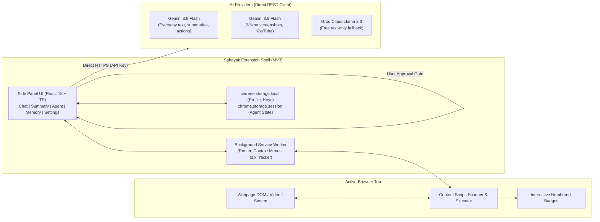
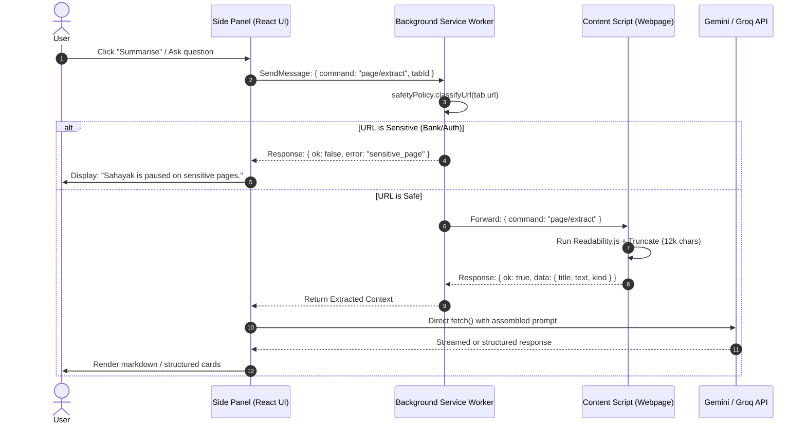
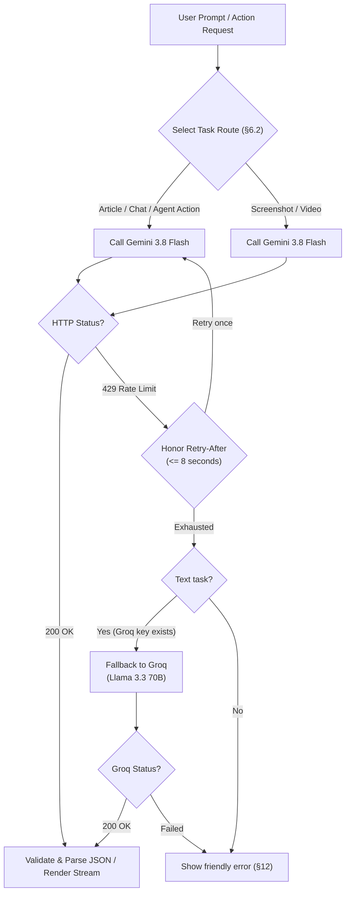
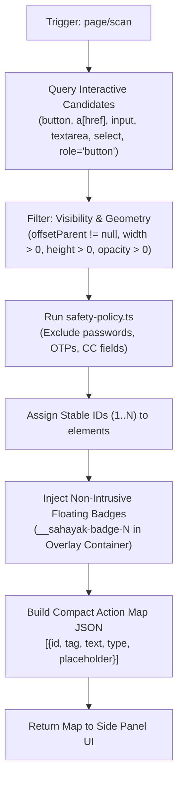
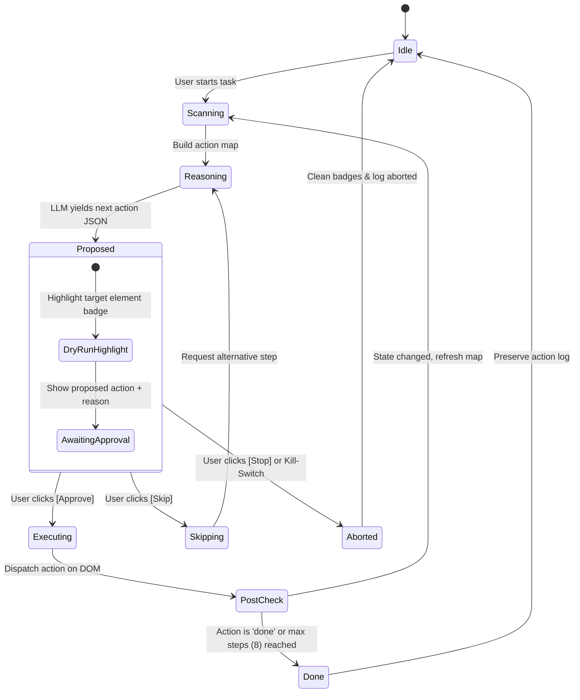
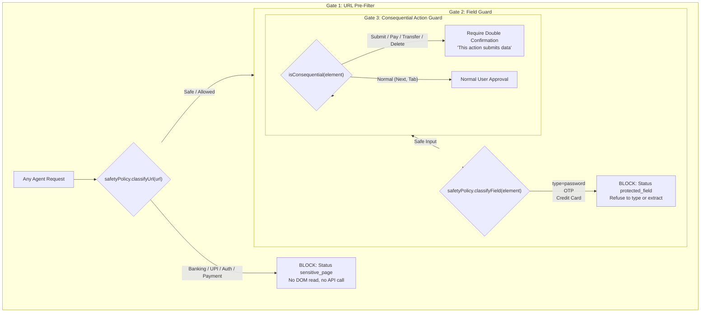

# Sahayak: Chrome Side-Panel AI Agent — System Architecture

> **Document Version:** 1.0.0  
> **Target Platform:** Google Chrome Desktop (Manifest V3)  
> **Reference Specification:** `AI-Web-browser-2.2.pdf`  
> **Status:** Implementation Blueprint  

---

## 1. Executive Summary & Core Philosophy

**Sahayak** is a context-aware Chrome side-panel AI agent that empowers users to understand web pages and take actions safely. Unlike fully autonomous browser agents that act behind closed curtains, Sahayak is built around strict **Human-in-the-Loop (HITL)** principles:
- **Understand the Page & Screen:** Extract clutter-free article text, parse public YouTube videos with timestamped chapters, answer grounded questions, and reason over visual screen captures.
- **Controlled Computer-Use:** Detect interactive DOM elements, assign a numbered action map, propose exactly **one step at a time**, and wait for explicit user approval (`Approve`, `Skip`, or `Stop`) before execution.
- **Deterministic Code-Level Safety:** Block actions on banking/UPI/payment portals, strictly refuse password/OTP fields, require double confirmation on consequential buttons, and isolate API credentials locally.
- **Free-Tier Resilient & Serverless:** Pure client-side Chrome extension (no external proxy backend required) running on free-tier Gemini Flash-Lite, with Gemini Flash for multimodal/reasoning and Groq (Llama 3.3 70B) as a text fallback.



---

## 2. Technology Stack

| Layer | Selected Technology | Version / Spec | Justification |
|---|---|---|---|
| **Platform** | Google Chrome Desktop Extension | Manifest V3 (MV3) | Latest Chrome extension standard; natively supports `chrome.sidePanel` and enhanced security models. |
| **Side Panel UI** | React 18 + TypeScript | React 18.3, TS 5.x | High-performance reactive UI with type safety; handles streaming tokens, action approvals, and state resets smoothly. |
| **Bundler & Tooling** | Vite + `@crxjs/vite-plugin` | Vite 5.x | Instant HMR for extension development, single-command production packaging, and seamless asset hashing. |
| **Styling** | Tailwind CSS + Lucide React | v3.4+ / Lucide Icons | Clean, responsive UI optimized for narrow side-panel constraints (~350px-450px width). |
| **Content Extraction** | Mozilla Readability.js | `@mozilla/readability` | Industry-standard DOM text cleaning: strips navigation, sidebars, advertisements, and footers. |
| **Screen Capture & Crop** | Native `tabs.captureVisibleTab` + Canvas | HTML5 2D Canvas | Zero external dependencies for screen cropping and resizing before vision model dispatch. |
| **Primary AI Engine** | Google Gemini 3.8 Flash | `gemini-3.8-flash` | State-of-the-art inference, high rate-limit allowances on free tier, structured JSON schema support. |
| **Vision / Heavy Reasoning**| Google Gemini 3.8 Flash (Fallback: 3.5 Flash-Lite) | `gemini-3.8-flash` | Multimodal visual inspection (screenshots) and direct native YouTube video URL comprehension. |
| **Text Fallback Engine** | Groq Cloud API | `llama-3.3-70b-versatile` | Ultra-low latency fallback when Gemini hits HTTP 429 rate limits for pure text prompts. |
| **Testing** | Vitest | Latest | Unit testing for safety policies, schema parsers, limits, and prompt assembly without Chrome mock bloat. |

---

## 3. Project Directory Structure

```
sahayak/
├── manifest.json                        # MV3 Extension manifest definition
├── package.json                         # Dependencies and build scripts
├── vite.config.ts                       # Vite bundler config with @crxjs plugin
├── tsconfig.json                        # Strict TypeScript compilation rules
├── assets/
│   ├── icons/                           # 16, 32, 48, 128px extension icons
│   └── logo.svg                         # Sahayak brand assets
├── src/
│   ├── background/                      # MV3 Service Worker (Lightweight lifecycle)
│   │   ├── index.ts                     # Worker bootstrap & install handlers
│   │   ├── messaging.ts                 # Message router (Panel <-> Worker <-> Content)
│   │   ├── tab-tracker.ts               # Active tab tracking (URL, title, state)
│   │   └── context-menus.ts             # Right-click selection menus (Explain, Translate, Draft)
│   │
│   ├── content/                         # Injected Content Scripts
│   │   ├── index.ts                     # Content script bootstrap & message dispatcher
│   │   ├── extract.ts                   # Mozilla Readability article extraction & truncation
│   │   ├── selection.ts                 # Current user text selection retriever
│   │   ├── scanner.ts                   # Interactive element detector & DOM numbering
│   │   ├── executor.ts                  # Safe browser action execution (click, type, select, scroll)
│   │   └── overlay.css                  # Isolated styles for numbered badges & focus glows
│   │
│   ├── sidepanel/                       # Chrome Side Panel UI (React Application)
│   │   ├── index.html                   # HTML entry point for the side panel
│   │   ├── main.tsx                     # React root mount
│   │   ├── app.tsx                      # Main app layout, active tab header, navigation tabs
│   │   └── components/
│   │       ├── header.tsx               # Active tab title, language toggle (EN/Hinglish), kill-switch
│   │       ├── summary.tsx              # Article TL;DR + 5 points & YouTube chapters
│   │       ├── chat.tsx                 # Grounded chat interface with streaming responses
│   │       ├── cropper.tsx              # Screenshot capture & canvas visual region selector
│   │       ├── agent.tsx                # HITL agent approval card, step progress, dry-run, logs
│   │       ├── profile.tsx              # Local user profile viewer and editor
│   │       ├── skills.tsx               # One-click prompt recipes (Run, Export, Import)
│   │       └── settings.tsx             # API key storage, model status, practice allowlist
│   │
│   ├── ai/                              # Model Clients & Prompt Orchestration
│   │   ├── client.ts                    # Unified HTTP client for Gemini & Groq (streaming, retry, 429)
│   │   ├── prompts.ts                   # Prompt templates with grounding and Hinglish directives
│   │   ├── parse.ts                     # Strict JSON schemas and validation parsers
│   │   └── youtube.ts                   # YouTube video ID extraction & timestamp calculations
│   │
│   └── shared/                          # Universal types, constants, and pure logic
│       ├── protocol.ts                  # Strictly typed IPC message envelopes and commands
│       ├── storage.ts                   # Type-safe wrappers for chrome.storage.local & session
│       ├── limits.ts                    # Guardrail constants (12k extract cap, 8 step limit, timeouts)
│       ├── models.ts                    # Pinned model identifiers and routing rules
│       └── safety-policy.ts             # Pure deterministic safety rules (URL & field classifiers)
└── tests/                               # Vitest unit test suite
    ├── safety-policy.test.ts            # Unit tests for banking/password/consequential safety rules
    ├── parse.test.ts                    # JSON parser integrity tests
    └── prompts.test.ts                  # Prompt assembly & token limits verification
```

---

## 4. Manifest V3 Specification

The `manifest.json` uses the minimum necessary permissions to maintain user trust and avoid security warnings during load-unpacked installation.

```json
{
  "manifest_version": 3,
  "name": "Sahayak — Side-Panel AI Agent",
  "version": "1.0.0",
  "description": "User-controlled Chrome side-panel AI agent for page understanding, summarisation, and safe browser actions.",
  "icons": {
    "16": "assets/icons/icon-16.png",
    "32": "assets/icons/icon-32.png",
    "48": "assets/icons/icon-48.png",
    "128": "assets/icons/icon-128.png"
  },
  "action": {
    "default_title": "Open Sahayak Side Panel",
    "default_icon": "assets/icons/icon-32.png"
  },
  "side_panel": {
    "default_path": "src/sidepanel/index.html"
  },
  "background": {
    "service_worker": "src/background/index.ts",
    "type": "module"
  },
  "permissions": [
    "sidePanel",
    "storage",
    "activeTab",
    "scripting",
    "contextMenus",
    "tabs"
  ],
  "host_permissions": [
    "<all_urls>"
  ],
  "content_scripts": [
    {
      "matches": ["<all_urls>"],
      "js": ["src/content/index.ts"],
      "run_at": "document_idle"
    }
  ],
  "content_security_policy": {
    "extension_pages": "script-src 'self'; object-src 'self';"
  }
}
```

### Key Manifest Behaviors:
1. **Direct Side Panel on Action Click:** Background service worker calls `chrome.sidePanel.setPanelBehavior({ openPanelOnActionClick: true })` during `onInstalled`.
2. **Restricted Storage Scope:** Keys and profile data reside in `chrome.storage.local`; ephemeral agent loops and pending context-menu intents live in `chrome.storage.session`.
3. **No External Scripts:** All third-party libraries (Readability, React, Lucide) are bundled into the extension bundle.

---

## 5. Inter-Process Communication (IPC) Protocol

All internal communications follow a strongly-typed request-response envelope defined in `src/shared/protocol.ts`.



### 5.1 Protocol Message Envelope

```typescript
// src/shared/protocol.ts

export type CommandType =
  | 'tab/getActive'
  | 'page/extract'
  | 'page/selection'
  | 'page/scan'
  | 'page/highlight'
  | 'page/clearBadges'
  | 'agent/execute'
  | 'capture/visible'
  | 'panel/ready';

export interface IPCRequest<T = any> {
  id: string;              // UUID for request correlation
  command: CommandType;    // Typed command name
  tabId?: number;          // Target tab ID (optional, defaults to active)
  payload?: T;             // Command-specific parameters
}

export interface IPCResponse<T = any> {
  id: string;              // Corresponds to request ID
  ok: boolean;             // Success flag
  data?: T;                // Result payload
  error?: {
    code: 'sensitive_page' | 'protected_field' | 'rate_limited' | 'model_unavailable' | 'off_page' | 'execution_failed';
    message: string;
  };
}
```

---

## 6. Gemini & Groq AI Pipeline

### 6.1 Calling Architecture & Secrets Isolation
- **Client-Side Direct Fetch:** The Side Panel directly initiates HTTPS requests to `generativelanguage.googleapis.com` and `api.groq.com`.
- **Zero API Key Leakage:** The Content Script **never** receives or has access to API keys. The keys stay exclusively in the extension's private `chrome.storage.local`.
- **No Backend Requirement:** Eliminates user onboarding friction and hosting costs.



### 6.2 Task-to-Model Routing Table

| Task | Primary Route | Fallback Route | Payload Modality | Output Requirement |
|---|---|---|---|---|
| **Article Summarisation** | `gemini-3.8-flash` | Groq `llama-3.3-70b-versatile` | Text (clean article body) | Strict JSON: `{ tldr, keyPoints[5], nextStep }` |
| **YouTube Summarisation** | `gemini-3.8-flash` | None (Direct video link) | Text (URL / File URI) | Strict JSON: `{ tldr, keyPoints, chapters[] }` |
| **Grounded Page Chat** | `gemini-3.8-flash` | Groq `llama-3.3-70b-versatile` | Text (Context + History) | Markdown stream with refusal when answer missing |
| **Context Menu Quick Action** | `gemini-3.8-flash` | Groq `llama-3.3-70b-versatile` | Text (Selection text) | Markdown stream (Explain / Translate / Draft) |
| **Screenshot-and-Ask** | `gemini-3.8-flash` | None (Requires Vision) | Image (`image/jpeg`, max 1280px) | Markdown stream answering user screen question |
| **Find It for Me** | `gemini-3.8-flash` | `gemini-3.5-flash-lite` | Text (Action Map) | Strict JSON: `{ elementId, reason }` |
| **Agent Step Proposal** | `gemini-3.8-flash` | `gemini-3.5-flash-lite` | Text (Action Map + Goal) | Strict JSON: Single step schema (§8.2) |

### 6.3 Prompt Assembly Order

Prompts are assembled strictly in the following hierarchy (`src/ai/prompts.ts`):
1. **System Guardrails:** Define role, grounding mandate ("Answer only from the provided page context. If not present, state clearly that it is not on this page."), and output format (JSON / Markdown).
2. **Language Directive:** Set output language. If `settings.language === 'hinglish'`, instruct the model: `"Respond in Hinglish (natural Hindi written in the English/Latin alphabet mixed with English terminology)"`.
3. **User Profile Memory:** Injected profile attributes (Name, College, Skills, Tone) when drafting replies or filling forms.
4. **Context Source:** Readability extract (capped at 12,000 characters with `[...truncated...]` middle marker) or numbered Action Map JSON.
5. **Conversation Turn History:** Rolling window of the last 8 conversation turns.
6. **User Input / Task Instruction:** The direct user command or query.

---

## 7. Content Script & DOM Element Scanner

The Content Script (`src/content/`) operates on the active page without breaking existing site functionality or introducing memory leaks.



### 7.1 Action Map Compact Structure
Rather than feeding hundreds of kilobytes of noisy raw HTML to the AI, the scanner distills the interactive DOM into a tiny JSON representation (typically under 1,500 tokens):

```json
[
  { "id": 1, "tag": "a", "text": "Documentation", "href": "/docs" },
  { "id": 2, "tag": "input", "type": "text", "name": "fullName", "placeholder": "Enter your full name" },
  { "id": 3, "tag": "input", "type": "email", "name": "email", "placeholder": "work@example.com" },
  { "id": 4, "tag": "select", "name": "country", "options": ["India", "USA", "Germany"] },
  { "id": 5, "tag": "button", "type": "submit", "text": "Next Step" }
]
```

### 7.2 Badging & Overlay Architecture
- **Isolated Overlay Layer:** Badges are rendered inside an absolutely positioned top-level `div#__sahayak-badge-container` using `pointer-events: none`.
- **Absolute Viewport Pinning:** Badge coordinates are computed using `element.getBoundingClientRect()` adjusted for `window.scrollX` / `window.scrollY`.
- **Zero Page Layout Disruption:** No alterations are made to the website’s DOM hierarchy, styling, or flexbox layouts.

### 7.3 Action Executor (`src/content/executor.ts`)
Executes only approved actions using synthetic browser events:
- **`click`:** Focuses the target, dispatches `pointerdown`, `mousedown`, `pointerup`, `mouseup`, and `click`.
- **`type`:** Focuses field, sets value via `HTMLInputElement.prototype` setter descriptor (ensures React/Vue synthetic input triggers), and dispatches `input` and `change` events.
- **`select`:** Sets the chosen value and triggers `change` event.
- **`scroll`:** Calls `element.scrollIntoView({ behavior: 'smooth', block: 'center' })`.

---

## 8. Human-In-The-Loop Agent Loop

Sahayak enforces a **one-step-at-a-time** execution lifecycle. It never chains automated clicks or form submissions without explicit user clearance.



### 8.1 Single-Step JSON Schema
Gemini outputs actions strictly matching this JSON interface:

```typescript
export interface AgentProposedAction {
  thought: string;        // Reasoning for this particular step
  action: 'click' | 'type' | 'select' | 'scroll' | 'done';
  elementId?: number;     // Target number corresponding to active badge
  value?: string;         // Value for 'type' or 'select' actions
  reason: string;         // Plain-language single line explanation for the user
}
```

### 8.2 Agent Controls & Fail-Safe Mechanics
1. **Human Approval Gateway:** The `Approve` button is required for every single execution. The user can also choose `Skip` to force the AI to rethink, or `Stop` to terminate the session.
2. **Dry-Run Target Preview:** Prior to clicking Approve, the target badge glows with an animated pulsing ring so the user can visually verify where the agent intends to interact.
3. **Hard Step Limit:** Hard cap of **8 steps per task** (`src/shared/limits.ts`). When the 8th step is reached, the agent automatically halts and requests user continuation.
4. **State Persistence Across Service-Worker Dormancy:**
   - Background service workers can enter sleep after 30 seconds of inactivity.
   - All active loop state (`currentStep`, `taskGoal`, `actionHistory`, `status`) is mirrored into `chrome.storage.session`.
   - When the user returns or the side panel wakes up, state is restored seamlessly without losing progress.
5. **Action Audit Log:** Every proposed action, its reason, the user's decision (`Approved`, `Skipped`, `Aborted`), and execution timestamp are persisted in local memory for user inspection.

---

## 9. Deterministic Safety Rails & Security Architecture

> [!IMPORTANT]
> Safety rules are enforced by **deterministic TypeScript code**, never by relying solely on system prompts or LLM obedience.



### 9.1 URL Denylist & Allowlist Strategy (`src/shared/safety-policy.ts`)
- **Restricted URL Patterns:**
  ```typescript
  export const SENSITIVE_URL_PATTERNS = [
    /bank/i, /paytm/i, /phonepe/i, /gpay/i, /upi/i, /razorpay/i, /stripe/i,
    /paypal/i, /checkout/i, /login/i, /signin/i, /auth0/i, /accounts\.google/i,
    /netbanking/i, /incometax/i, /uidai/i
  ];
  ```
  If `classifyUrl(url)` matches, the extension immediately halts with the status `sensitive_page`. The DOM is neither parsed nor transmitted to any model.
- **Agent Allowlist:** By default, automated practice tasks are restricted to local test environments:
  - `http://localhost:*`
  - `http://127.0.0.1:*`
  - Explicit user-whitelisted domains in extension settings.
  *(Note: A sensitive domain remains blocked even if a user attempts to add it to the allowlist).*

### 9.2 Protected Field Inspection
Before any `type` action is registered or executed:
- Elements with `type="password"` are strictly excluded from the scanner.
- Elements with `autocomplete="one-time-code"`, `autocomplete="cc-number"`, `cc-csc`, `cc-exp` are filtered out.
- Fields with names, IDs, placeholders, or aria labels matching `/otp|cvv|card|pass|pin|ssn|aadhar/i` are marked protected and will reject synthetic keyboard input.

### 9.3 Consequential Action Double-Gate
When an approved action targets a button or link with semantic labels such as:
- `Submit`, `Pay`, `Pay Now`, `Transfer`, `Send Email`, `Delete`, `Confirm Order`
The UI requires a **secondary explicit confirmation modal**:
> *"Warning: This is a consequential action that will submit information or initiate a transaction. Are you sure you want Sahayak to proceed?"*

### 9.4 Global Emergency Kill-Switch
A persistent red **"STOP" button** is anchored at the top of the side-panel header at all times during an active task. Clicking it:
1. Immediately cancels pending content-script timers.
2. Removes all injected badges and highlights from the page DOM.
3. Sets the session state to `aborted`.

---

## 10. Local Profile Memory & One-Click Skills

### 10.1 Local Profile (`chrome.storage.local`)
To eliminate repetitive typing in supported practice forms or email drafts, Sahayak stores a lightweight personal profile entirely on the user's local machine:

```typescript
export interface UserProfile {
  fullName: string;
  email: string;
  phone: string;
  college: string;
  graduationYear: string;
  skills: string[];
  links: {
    github: string;
    linkedin: string;
    portfolio: string;
  };
  preferredLanguage: 'en' | 'hinglish';
  preferredTone: 'formal' | 'casual' | 'concise';
}
```

### 10.2 One-Click Skills
Users can save, customize, and execute reusable prompt recipes:
- **Exam Notes:** Distill page into definitions, core equations, and review questions.
- **Explain in Hinglish:** Simplify complex jargon in relatable conversational Hindi (Latin script).
- **Reply Politely:** Draft a polite response to an email or LinkedIn message.
- **Fill Form from Profile:** Map local user profile fields to current interactive inputs.
- **Portability:** Export and import skills as a clean `.json` file for backup or team sharing.

---

## 11. Error Handling & User Copy Dictionary

Sahayak translates raw technical errors and HTTP status codes into clear, actionable user messages (`src/shared/limits.ts`):

| Error Code | Trigger Condition | Exact User-Facing Message |
|---|---|---|
| `missing_key` | User has not configured their Gemini API key in settings. | *"Please enter your Gemini API key in Settings to get started."* |
| `model_unavailable` | Network down, 5xx error, or both Gemini and fallback failed. | *"The AI service is temporarily unavailable. Please check your connection and try again."* |
| `rate_limited` | HTTP 429 received from primary API and fallback is unavailable. | *"Sahayak is waiting for the free model. Please try again in a few moments."* |
| `sensitive_page` | URL matches banking, payment, checkout, or login denylist. | *"Sahayak is paused for your safety: Actions are disabled on sensitive or private pages."* |
| `protected_field` | Action targeted a password, OTP, or credit card field. | *"For your protection, Sahayak cannot interact with password or financial fields."* |
| `off_page` | Grounded chat query cannot be answered from page content. | *"This information is not available on the current page."* |
| `max_steps_reached`| Agent loop completed 8 consecutive steps. | *"Maximum step limit reached (8 steps). Please review the page and resume if needed."* |

---

## 12. Four-Week Implementation & Slice Matrix

The project is structured into vertical, testable slices that run under Chrome’s **Load Unpacked** flow from day one:

```
Week 1: The Eyes (Slices 1–5)
├── Slice 1: Extension shell, side panel, settings UI, and pure safety policy
├── Slice 2: First Gemini text call (plumbing test)
├── Slice 3: Readability.js article extraction & structured summary (TL;DR, 5 points, next step)
├── Slice 4: Public YouTube summarisation with clickable chapter timestamps
└── Slice 5: English / Hinglish output language toggle

Week 2: The Brain (Slices 6–9)
├── Slice 6: Grounded page chat with streaming tokens & out-of-context refusal
├── Slice 7: Context-menu actions (Explain this, Translate, Draft a reply)
├── Slice 8: Screenshot-and-ask with HTML5 canvas visual region cropper
└── Slice 9: Free-tier resilience (HTTP 429 retry, Groq text fallback, user error copy)

Week 3: The Hands (Slices 10–13)
├── Slice 10: Interactive DOM element scanner and visual numeric badges
├── Slice 11: Structured element selection ("Find It for Me")
├── Slice 12: Approval-based agent loop (One step at a time: Approve, Skip, Stop)
└── Slice 13: Progress persistence in session storage, dry-run mode, and action logs

Week 4: Memory, Safety & Shipping (Slices 14–17)
├── Slice 14: Local profile memory for auto-filling and drafting
├── Slice 15: One-click skills engine (execution, export, and import)
├── Slice 16: Complete safety rails integration (URL denylist, field gates, double confirmation)
└── Slice 17: Release packaging (clean README, GitHub release ZIP, and landing page)
```

---

## 13. Quality Gates & Definition of Done

A slice or feature is only considered **Done** when:
1. It builds cleanly (`npm run build`) without TypeScript or linter errors.
2. It passes unit tests in Vitest for safety rules and JSON parsing.
3. It loads in Chrome via **Load Unpacked** without runtime console errors.
4. It enforces safety gates deterministically (sensitive pages are never sent to external models; password/OTP fields are never typed into).
5. All user interactions are routed through the Side Panel while keeping the user in full control.

