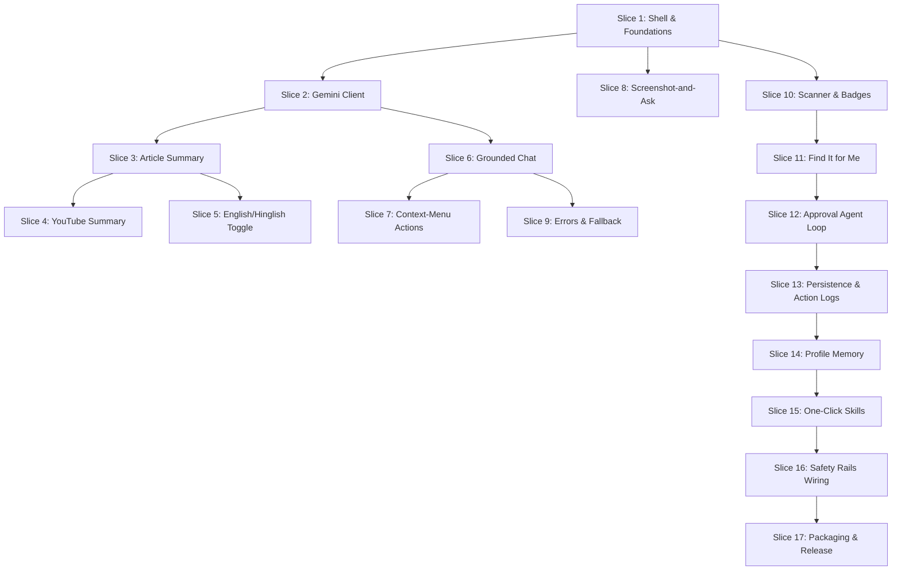

# Sahayak: Phase-Wise Implementation Plan

> **Project:** Sahayak — Chrome Side-Panel AI Agent  
> **Source Spec:** `AI-Web-browser-2.2.pdf`  
> **Architecture Reference:** `architecture.md`  
> **Target Execution Environment:** Google Chrome Desktop (Manifest V3)  

---

## Plan Overview & Engineering Rules

This plan breaks the 4-week build into **4 Phases** and **17 Vertical Slices**. Work on **one slice at a time** in strict numerical order. A slice is considered complete **only when it runs in Chrome under "Load unpacked" and passes its manual testing steps and automated unit tests**.

### Golden Implementation Rules
1. **Never skip slices:** Finish and verify the current slice in Chrome before creating files for the next.
2. **Side-Panel-Only AI Calls:** The side panel is the **sole caller** of Gemini and Groq APIs. The content script **never** sees or handles API keys.
3. **Session Persistence:** Save active agent loop states, approvals, and pending intents in `chrome.storage.session`, not in service-worker memory (which sleeps after 30 seconds of inactivity).
4. **Deterministic Safety-First:** Pure safety validation code (`src/shared/safety-policy.ts`) starts in Slice 1 and gates every subsequent slice that touches the page DOM, network, or inputs.
5. **Keep It Simple & Zero-Backend:** The entire extension runs client-side with direct HTTPS requests to AI providers. No proxy servers or external infrastructure required.

---

## Phase Map

| Phase | Week | Theme & Milestone | Slices |
|---|---|---|---|
| **Phase 1: The Eyes** | Week 1 | Extension loads, reads web pages, extracts articles, parses public YouTube videos, English/Hinglish toggle. | **Slices 1 – 5** |
| **Phase 2: The Brain** | Week 2 | Grounded page chat, context-menu actions, screenshot region Q&A, HTTP 429 rate-limit fallback. | **Slices 6 – 9** |
| **Phase 3: The Hands** | Week 3 | Numbered action map, "Find It for Me", human-approval agent loop, dry-run, session persistence. | **Slices 10 – 13** |
| **Phase 4: Memory & Ship** | Week 4 | Local profile memory, 1-click skills (import/export), deterministic safety rails, packaging & docs. | **Slices 14 – 17** |

---

# Phase 1 — The Eyes: Read the Web (Week 1)

**Goal:** Establish the Chrome extension foundation, open the side panel, connect the Gemini API key, extract and summarise article text with Readability.js, parse public YouTube videos, and support an English/Hinglish toggle.

---

### Slice 1: Extension Shell, Side Panel & Settings

#### 1. What to Build
Scaffold the extension build system with Vite, React 18, and TypeScript using `@crxjs/vite-plugin`. Create the Manifest V3 structure with the side panel enabled. Provide a Settings UI in the side panel where the user enters and saves their Gemini API key (and optional Groq key) into `chrome.storage.local`. Implement the shared foundation modules (`protocol.ts`, `storage.ts`, `limits.ts`, and `safety-policy.ts`) with unit tests.

#### 2. Files to Create / Modify
- `package.json` — Vite, React, TypeScript, Tailwind CSS, Lucide React, Vitest, `@crxjs/vite-plugin`.
- `vite.config.ts` — CRXJS manifest plugin configuration.
- `tsconfig.json` — Strict TypeScript compiler options.
- `manifest.json` — MV3 declarations (permissions: `sidePanel`, `storage`, `activeTab`, `scripting`, `contextMenus`, `tabs`; host permissions: `<all_urls>`).
- `src/background/index.ts` — Service worker entry, `openPanelOnActionClick: true`.
- `src/background/messaging.ts` — Router for `panel/ready` and `tab/getActive`.
- `src/background/tab-tracker.ts` — Tracks active tab URL, title, and tabId.
- `src/sidepanel/index.html` — HTML shell for side panel.
- `src/sidepanel/main.tsx` — React root mount.
- `src/sidepanel/app.tsx` — Shell layout: header with active tab title, tabs navigation, and content area.
- `src/sidepanel/components/settings.tsx` — API key inputs, save status, and model connection indicators.
- `src/shared/protocol.ts` — IPC command types and request/response envelope.
- `src/shared/storage.ts` — Typed `chrome.storage.local` and `chrome.storage.session` getters/setters.
- `src/shared/limits.ts` — Limits (12k extract cap, 4k selection cap, 8 step limit, 30s timeout).
- `src/shared/safety-policy.ts` — Pure TypeScript classification functions (`classifyUrl`, `classifyField`, `isConsequentialName`).
- `.gitignore` — Ignore `dist/`, `node_modules/`, `.env*`.
- `tests/safety-policy.test.ts` — Vitest unit tests for URL denylist, field classifiers, and consequential action names.

#### 3. Acceptance Criteria
- Extension builds cleanly (`npm run build`) without TypeScript errors.
- Vitest tests pass for URL denylist (bank hosts, `/checkout`, `/login`), field rules (`type=password`, `autocomplete=one-time-code`), and consequential keywords (`Submit`, `Pay`, `Send`).
- Empty API key displays a friendly empty state ("Please enter your Gemini API key in Settings").
- Saved API key persists in `chrome.storage.local` across browser reloads.
- The repository never contains hard-coded API keys.

#### 4. Manual Testing Steps in Chrome
1. Run `npm run build` (or `npm run dev`).
2. Open Chrome and navigate to `chrome://extensions/`.
3. Enable **Developer mode** (top right) and click **Load unpacked**.
4. Select the project's `dist/` directory. Verify the extension loads without error warnings.
5. Click the Sahayak icon in the Chrome toolbar. Confirm that the side panel opens on the right.
6. Open any normal website (e.g., `https://en.wikipedia.org`). Confirm the active tab title displays in the side-panel header.
7. Open the **Settings** view in the side panel, paste a test Gemini API key, and click **Save**.
8. Close and reopen the side panel. Confirm the key remains saved and marked configured.
9. Inspect Chrome DevTools console for the side panel and ensure there are zero errors.

---

### Slice 2: First Gemini Text Call

#### 1. What to Build
Implement the basic AI plumbing: a unified client (`src/ai/client.ts`) that executes direct HTTPS `POST` requests to Google Gemini’s REST endpoint using `gemini-2.0-flash-lite`. Add a temporary prompt box (`src/sidepanel/components/ask-box.tsx`) in the side panel to send a test prompt and display the AI's response. Wire the task-to-model routing table (`src/shared/models.ts`).

#### 2. Files to Create / Modify
- `src/shared/models.ts` — Pinned model IDs (`gemini-3.8-flash`, `gemini-3.5-flash-lite`, `gemini-3.6-flash`, `llama-3.3-70b-versatile`) and route mappings.
- `src/ai/client.ts` — `generateText()` with 30s timeout, error mappings for `missing_key` and `model_unavailable`.
- `src/ai/prompts.ts` — `buildPrompt({ task, language, page, profile, history, userText })`.
- `src/sidepanel/components/ask-box.tsx` — Input textarea, send button, loading spinner, and response box.
- `src/sidepanel/app.tsx` — Mount `AskBox` temporarily in the active panel tab.

#### 3. Acceptance Criteria
- Sending a prompt successfully hits `https://generativelanguage.googleapis.com/v1beta/models/gemini-3.8-flash:generateContent`.
- If the API key is missing or blank, the client rejects with `missing_key` without making any network call.
- Network timeouts (>30s) or HTTP 5xx errors return `model_unavailable` with the friendly copy from architecture §11.
- Unit tests verify `buildPrompt` formats the prompt correctly.

#### 4. Manual Testing Steps in Chrome
1. Reload the unpacked extension in Chrome.
2. Open the side panel and navigate to the test text prompt box.
3. With an API key saved, type *"Hello! What model are you?"* and click **Send**.
4. Verify a loading state appears, followed by Gemini's response rendered in the UI.
5. Go to Settings, delete the API key, and attempt to send a message. Verify no network request is sent and the panel shows: *"Please enter your Gemini API key in Settings to get started."*
6. Restore your valid API key.

---

### Slice 3: Article Extraction & Structured Summary

#### 1. What to Build
Implement clutter-free web article extraction in the content script using Mozilla Readability.js. Add a content script message handler for `page/extract`. When triggered, extract the main body text, remove ads/nav/footers, cap the text at 12,000 characters (preserving 6,000 chars from the start and 6,000 from the end if truncated), and send it to `gemini-3.8-flash`. Parse the response into a structured summary: One-line **TL;DR**, **Five key points**, and **What to do next**.

#### 2. Files to Create / Modify
- `src/content/extract.ts` — Clones `document`, runs Readability, extracts clean text, falls back to clipped `innerText`, and applies 12,000 character head+tail truncation.
- `src/content/index.ts` — Message dispatcher handling `page/extract`.
- `src/ai/parse.ts` — `parseSummary()` JSON validator with strict schema enforcement.
- `src/sidepanel/components/summary.tsx` — Structured summary cards for TL;DR, 5 bullet points, and next steps.
- `src/sidepanel/app.tsx` — Add "Summary" navigation tab.
- `tests/parse.test.ts` — Tests verifying valid summary JSON parsing, fallback on truncated responses, and rejection of malformed schemas.

#### 3. Acceptance Criteria
- Extract excludes header, footer, ads, and navigation chrome.
- Text truncation preserves the first 6,000 and last 6,000 characters with a clear `[...content truncated for length...]` marker.
- Output always formats strictly into:
  1. `tldr`: Single sentence.
  2. `keyPoints`: Exactly 5 clear points (if the model returns more, slice to 5).
  3. `nextStep`: Concrete action recommendation.
- Navigating to a sensitive URL (e.g. `https://example.com/login`) immediately halts extraction with `sensitive_page`.

#### 4. Manual Testing Steps in Chrome
1. Reload the extension in Chrome.
2. Visit a content-rich news article (e.g. Wikipedia article or BBC news post).
3. Open the Sahayak side panel and click the **Summary** tab.
4. Click **Summarise Article**. Verify the extraction spinner shows briefly.
5. Verify the rendered output contains:
   - A bold TL;DR card.
   - An ordered list of exactly 5 bullet points.
   - A "What to do next" callout box.
6. Open a banking or login URL (e.g. `https://github.com/login`). Click **Summarise Article**.
7. Confirm that extraction is blocked and the panel displays: *"Sahayak is paused for your safety: Actions are disabled on sensitive or private pages."*

---

### Slice 4: Public YouTube Summarisation

#### 1. What to Build
Add native support for public YouTube video summarisation. Detect when the active tab URL is a YouTube watch URL (`https://www.youtube.com/watch?v=...`). Skip DOM text extraction and instead route the video URL directly to `gemini-2.0-flash` (which natively ingests public YouTube video links). Parse the response into the standard summary format plus **chapter-style notes with clickable timestamps** that jump the active video to that exact second.

#### 2. Files to Create / Modify
- `src/ai/youtube.ts` — Video ID extraction (`v` query param), timestamp parser (converts `mm:ss` and `h:mm:ss` to total seconds `&t=...`).
- `src/shared/models.ts` — Route `youtube_summary` task to `gemini-3.8-flash`.
- `src/ai/parse.ts` — Extend summary parser to extract optional `chapters: [{ timestamp: string, seconds: number, note: string }]`.
- `src/sidepanel/components/summary.tsx` — Render clickable timestamp badges that send a seek command to the YouTube tab.
- `tests/youtube.test.ts` — Tests for timestamp math (`1:02` &rarr; `62`, `1:02:03` &rarr; `3722`).

#### 3. Acceptance Criteria
- YouTube watch URLs are detected automatically; kind is tagged as `youtube`.
- Summaries include video TL;DR, 5 takeaways, and clickable chapter links.
- Clicking a timestamp link executes a script on the YouTube tab to set `videoElement.currentTime = seconds`.
- Non-YouTube articles do not display the chapters section.
- Unsupported or private YouTube videos display a clear error message without crashing.

#### 4. Manual Testing Steps in Chrome
1. Open a public YouTube video with distinct chapters or speech (e.g. a tutorial or TED talk).
2. Open Sahayak side panel &rarr; **Summary** tab.
3. Click **Summarise Video**.
4. Confirm the generated summary includes chapter notes with timestamps (e.g. `02:15 - Introduction to MV3`).
5. Click on `02:15`. Verify the video in the active YouTube tab immediately jumps to 2 minutes and 15 seconds.
6. Open a standard blog post and confirm only standard article summary sections appear.

---

### Slice 5: English / Hinglish Toggle

#### 1. What to Build
Add an output language toggle in the side-panel header allowing users to switch seamlessly between **English** and **Hinglish** (conversational Hindi written in the English/Latin script mixed with English technical terms). Persist the selection in `chrome.storage.local` under `settings.language`. Inject the language directive into `src/ai/prompts.ts` so all summaries and future chat answers respect the chosen language.

#### 2. Files to Create / Modify
- `src/sidepanel/components/header.tsx` — Language toggle switch (`EN` | `HI-EN`).
- `src/shared/storage.ts` — Add `language: 'en' | 'hinglish'` to settings schema.
- `src/ai/prompts.ts` — Add language system instruction: when `hinglish`, output natural Hindi in Latin script (e.g. *"Yeh article batata hai ki Chrome MV3 extensions kaise banayein..."*).
- `src/sidepanel/app.tsx` — Connect header state with global storage.

#### 3. Acceptance Criteria
- Clicking the toggle updates `settings.language` in `chrome.storage.local`.
- Reloading the side panel retains the user's language selection.
- When Hinglish is active, new summaries generate in natural Hinglish Latin script.
- Pre-existing rendered summaries or messages remain unchanged until re-requested.

#### 4. Manual Testing Steps in Chrome
1. Open any news article and open the Sahayak side panel.
2. In the top header, click the toggle to switch from **EN** to **Hinglish**.
3. Click **Summarise Article**.
4. Verify the TL;DR and 5 bullet points are written in clear, natural Hinglish using the Latin script.
5. Close and reopen the side panel. Confirm the toggle remains on **Hinglish**.
6. Switch back to **EN** and verify that subsequent requests return English.

---

# Phase 2 — The Brain: Understand the Page & Screen (Week 2)

**Goal:** Transform the side panel into a conversational companion that chats with the page context, supports quick right-click actions, answers visual questions about cropped screen areas, and handles API rate limits gracefully.

---

### Slice 6: Grounded Page Chat

#### 1. What to Build
Implement a full conversational chat interface in the side panel. On every message, refresh the extracted page text (skipping sensitive URLs) and send the user query, page context, and rolling history (last 8 turns) to `gemini-3.8-flash`. Support streaming responses (via Server-Sent Events / chunked transfer) so tokens appear in real time. Enforce strict grounding: if the question cannot be answered from the page, the model must explicitly state that the answer is not available on this page (`off_page`).

#### 2. Files to Create / Modify
- `src/ai/client.ts` — Add `generateStreamText()` for streaming tokens into a callback.
- `src/sidepanel/components/chat.tsx` — Chat message thread, autoscrolling container, markdown renderer, and prompt composer.
- `src/sidepanel/app.tsx` — Add "Chat" tab and wire active tab state.
- `src/background/tab-tracker.ts` — Detect tab switches and reset chat transcript for the newly active page.

#### 3. Acceptance Criteria
- Answers are strictly grounded in extracted page text.
- If the question is unrelated or absent from the page, the assistant answers with: *"This information is not available on the current page."*
- Tokens stream into the message bubble in real time.
- Chat history retains up to 8 conversation turns for the active tab.
- Switching to another Chrome tab clears or stores the previous tab's transcript and displays the new page title.

#### 4. Manual Testing Steps in Chrome
1. Open a Wikipedia page about an author (e.g., *Ada Lovelace*).
2. Open Sahayak &rarr; **Chat** tab.
3. Ask: *"What was her main contribution mentioned here?"*
4. Confirm tokens stream smoothly and the answer quotes/reflects the article content.
5. Ask an ungrounded question: *"What is the capital of Iceland?"*
6. Verify the model replies: *"This information is not available on the current page."*
7. Open a new tab (e.g. Google Search) and switch to it. Verify the chat transcript resets for the new tab.

---

### Slice 7: Context-Menu AI Actions

#### 1. What to Build
Register Chrome context-menu items when the user selects text on any webpage: **"Explain this"**, **"Translate"**, and **"Draft a reply"**. When clicked, write a `pendingIntent` object (`{ kind, selectionText, tabId, url, createdAt }`) into `chrome.storage.session`, open the side panel automatically, route the intent into the Chat thread, and trigger the AI action immediately.

#### 2. Files to Create / Modify
- `src/background/context-menus.ts` — Create context menus on `chrome.runtime.onInstalled`:
  - `sahayak-explain` &rarr; "Explain this with Sahayak"
  - `sahayak-translate` &rarr; "Translate with Sahayak"
  - `sahayak-draft` &rarr; "Draft reply with Sahayak"
- `src/content/selection.ts` — Helper to retrieve selection text if panel is already open.
- `src/shared/storage.ts` — `pendingIntent` helper functions (with 2-minute expiration drop).
- `src/sidepanel/components/chat.tsx` — Handle incoming intents and render prompt + AI response.

#### 3. Acceptance Criteria
- Right-clicking highlighted text presents the three Sahayak menu options.
- Clicking an option opens the side panel, displays the selection, and runs the designated prompt.
- **Explain** simplifies jargon into plain English/Hinglish.
- **Translate** converts text into Hindi (or configured language) without changing the global toggle.
- **Draft a reply** drafts a contextual response appropriate for an email or forum message.
- Selections on sensitive URLs (banking, passwords) are blocked and never sent to the model.

#### 4. Manual Testing Steps in Chrome
1. Highlight a technical paragraph on a blog post or documentation page.
2. Right-click the selection &rarr; choose **Explain this with Sahayak**.
3. Verify the side panel opens immediately and streams a simplified explanation of the highlighted text.
4. Highlight an email or discussion forum comment &rarr; right-click &rarr; choose **Draft reply with Sahayak**.
5. Confirm a polite draft reply appears in the chat thread.
6. Verify on a login page that context-menu actions display the safety warning without sending data.

---

### Slice 8: Screenshot-and-Ask

#### 1. What to Build
Allow users to capture the visible tab and ask questions about visual content (charts, diagrams, errors, layouts) that cannot be understood from text alone. In the side panel, clicking "Ask about this screen" triggers `chrome.tabs.captureVisibleTab`. Render the screenshot on a canvas (`src/sidepanel/components/cropper.tsx`), let the user drag a box to crop the relevant region (or skip to use full frame), export a compressed JPEG (max 1280px, quality 0.7), and send it to `gemini-3.8-flash`.

#### 2. Files to Create / Modify
- `src/background/messaging.ts` — Handle `capture/visible` via `chrome.tabs.captureVisibleTab`. Refuse sensitive URLs.
- `src/sidepanel/components/cropper.tsx` — Canvas crop tool with draggable selection box and Confirm/Cancel buttons.
- `src/shared/models.ts` — Route `screen_qa` to `gemini-3.8-flash`.
- `src/sidepanel/components/chat.tsx` — Add "Ask about screen" button, image preview thumbnail, and vision Q&A flow.

#### 3. Acceptance Criteria
- Clicking "Ask about screen" captures the active tab as a PNG data URL.
- User can drag a rectangular bounding box to crop the image.
- Image is resized to a maximum dimension of 1280px at 0.7 JPEG quality to conserve bandwidth.
- Image data URLs are held in memory only during the active query; they are **never** stored in `chrome.storage` or written to disk.
- Screen capture is blocked on URLs classified as sensitive.

#### 4. Manual Testing Steps in Chrome
1. Open a page displaying a chart or infographic (e.g. *Our World in Data* or a GitHub traffic graph).
2. Open Sahayak &rarr; **Chat** tab &rarr; click **Ask about screen**.
3. Drag a crop rectangle tightly around the chart and click **Confirm Crop**.
4. Type: *"What is the peak value shown in this graph?"* and send.
5. Confirm the response accurately reads and describes the data from the image.
6. Click Cancel on a crop and confirm the canvas closes without making any network call.

---

### Slice 9: Errors, Retry & Groq Fallback

#### 1. What to Build
Harden the extension against free-tier model limits. When Gemini returns HTTP 429 (Rate Limit), inspect the `Retry-After` header (wait up to 8 seconds) and retry once. If still limited (or on 5xx errors), fail over automatically to **Groq Cloud API** (`llama-3.3-70b-versatile`) for eligible text tasks. Display user-friendly status copy while waiting: *"Sahayak is waiting for the free model."*

#### 2. Files to Create / Modify
- `src/ai/client.ts` — Implement retry loops, exponential backoff, Groq REST caller, and fallback router.
- `src/sidepanel/components/settings.tsx` — Add optional Groq API key field and provider status badge.
- `src/shared/limits.ts` — Friendly error strings mapping technical codes to user copy (§11 of architecture).
- `tests/client.test.ts` — Mock fetch tests verifying:
  - 429 followed by 200 calls Gemini twice and succeeds.
  - 429 followed by 429 falls back to Groq for text tasks.
  - 429 on image/video tasks fails gracefully with clear error without calling Groq (Groq is text-only).

#### 3. Acceptance Criteria
- Temporary HTTP 429 triggers an automatic wait-and-retry before alerting the user.
- Text tasks cleanly fall back to Groq Llama 3.3 when Gemini is exhausted and a Groq key is configured.
- Vision and YouTube tasks never fall back to Groq (fail fast with descriptive message).
- Errors display friendly sentences (e.g. *"The AI service is temporarily unavailable..."*), never raw stack traces or JSON payloads.

#### 4. Manual Testing Steps in Chrome
1. In Settings, add a valid Groq API key alongside your Gemini key.
2. In `src/ai/client.ts`, temporarily toggle a `FORCE_FALLBACK = true` debug flag.
3. Ask a question in Chat. Confirm the answer is received from Groq Llama 3.3 and a subtle badge indicates *"Answered via Groq Fallback"*.
4. Remove the debug flag.
5. Invalidate the Gemini API key in settings (add extra characters) and test: confirm the panel displays `model_unavailable` with clean user copy.

---

# Phase 3 — The Hands: Act With User Approval (Week 3)

**Goal:** Give Sahayak controlled browser interaction capabilities. Scan the page for interactive elements, display numbered DOM badges, enable natural-language element location ("Find It for Me"), and implement the one-step-at-a-time human-approval agent loop.

---

### Slice 10: Interactive Element Scanner & Numbered Action Map

#### 1. What to Build
Build a robust content script scanner (`src/content/scanner.ts`) that detects visible interactive elements on the page (`<button>`, `<a>`, `<input>`, `<textarea>`, `<select>`, and `[role="button"]`). Filter out hidden/zero-size elements and protected fields. Assign each valid element a stable sequential number (1, 2, 3...) for the current page state. Inject floating badges into an isolated overlay layer (`__sahayak-badge-container`). Construct a compact Action Map JSON for the AI.

#### 2. Files to Create / Modify
- `src/content/scanner.ts` — Element discovery, visibility filtering, bounding rect math, and Action Map JSON builder.
- `src/content/overlay.css` — Isolated CSS for numbered pill badges and target focus glow.
- `src/content/index.ts` — Add handlers for `page/scan` and `page/clearBadges`.
- `src/sidepanel/components/agent.tsx` — Add "Scan Page" button to view detected elements.
- `tests/scanner.test.ts` — Unit tests for Action Map JSON builder and element filtering.

#### 3. Acceptance Criteria
- Only visible elements in the current viewport/DOM are numbered.
- Protected inputs (`type="password"`, `autocomplete="one-time-code"`) are strictly ignored and never given a badge.
- Numbered badges appear floating beside their respective elements with high contrast and `pointer-events: none`.
- Action Map JSON stays compact: under 1,500 tokens for average pages.
- Calling `page/clearBadges` cleanly removes all injected badge nodes from the DOM.

#### 4. Manual Testing Steps in Chrome
1. Open a test web form (e.g. `http://localhost:3000` or a public practice form like W3Schools HTML form).
2. Open Sahayak &rarr; **Act** tab &rarr; click **Scan Page**.
3. Verify bright yellow/blue numbered badges appear next to inputs, dropdowns, and buttons.
4. Verify password fields have **no badge**.
5. Resize or scroll the page and confirm badges track their targets or re-align.
6. Click **Clear Badges** and ensure the page DOM returns completely to normal.

---

### Slice 11: Structured Element Selection ("Find It for Me")

#### 1. What to Build
Implement the "Find It for Me" navigation tool. The user types a natural-language query such as *"Where do I upload my resume?"* or *"Where is the pricing table?"*. The side panel scans the page, sends the user request alongside the compact Action Map JSON to `gemini-3.8-flash`, and expects a strict JSON response: `{ elementId: number, reason: string }`. The extension then scrolls the target element into view and applies an animated highlight ring without clicking it.

#### 2. Files to Create / Modify
- `src/ai/prompts.ts` — Add `buildFindElementPrompt(actionMap, query)`.
- `src/ai/parse.ts` — Add `parseFindElementResponse()`.
- `src/content/scanner.ts` — Add `highlightElement(elementId)` (scrolls into view + pulses border).
- `src/sidepanel/components/agent.tsx` — "Find It for Me" input box and result card.

#### 3. Acceptance Criteria
- Model outputs strict JSON conforming to `{ elementId: number, reason: string }`.
- Target element is smoothly scrolled into the center of the viewport.
- Target badge and element border pulse with an attention-grabbing highlight.
- **Zero autonomous action:** The element is highlighted only; no click or input event is fired.

#### 4. Manual Testing Steps in Chrome
1. Open an e-commerce or sign-up practice page with multiple inputs and buttons.
2. In Sahayak &rarr; **Act** tab &rarr; find the "Find It for Me" box.
3. Type: *"Where do I submit this form?"* and press Enter.
4. Confirm the extension scans the page, identifies the correct Submit button ID, scrolls down to it, and highlights it with an animated ring.
5. Confirm the side panel displays the reason: *"Highlighted element #5: Submit button for the application."*

---

### Slice 12: Approval-Based Agent Loop

#### 1. What to Build
Implement the core **One-Step-At-A-Time Agent Loop**. The user specifies a goal (e.g., *"Fill the contact form with name John Doe and email john@example.com"*). Sahayak executes the step-by-step cycle:
1. Scan page and build action map.
2. Send goal + map to Gemini 3.8 Flash.
3. Receive proposed single action (`click`, `type`, `select`, `scroll`, `done`).
4. Display proposed step and plain-language reason to the user.
5. **Wait for user input:** `Approve`, `Skip`, or `Stop`.
6. Execute the action via `src/content/executor.ts` **only** upon clicking `Approve`.
7. Refresh page state and repeat until the task is complete or stopped.

#### 2. Files to Create / Modify
- `src/content/executor.ts` — Programmatic dispatchers for `click`, `type` (with synthetic React input events), `select`, and `scroll`.
- `src/sidepanel/components/agent.tsx` — Agent proposal card, `Approve`, `Skip`, and `Stop` action controls.
- `src/shared/protocol.ts` — Add `agent/execute` command.
- `src/ai/prompts.ts` — Add `buildAgentStepPrompt()`.

#### 3. Acceptance Criteria
- **Zero autonomous execution:** Browser actions **never** run without the user explicitly clicking `Approve`.
- User clicking `Skip` asks the AI for an alternative step without executing the current one.
- User clicking `Stop` terminates the loop immediately.
- Supported actions (`click`, `type`, `select`, `scroll`, `done`) execute reliably across native HTML and React forms.
- Reaches `done` state cleanly when the goal is achieved.

#### 4. Manual Testing Steps in Chrome
1. Open a practice internship form with text fields, a dropdown, and checkboxes.
2. In Sahayak &rarr; **Act** tab, enter task: *"Fill out my name as Alex and choose India in the country dropdown"*.
3. Click **Start Task**.
4. Observe step 1 proposal: *"Type 'Alex' into Full Name (element #2)"*.
5. Click **Approve**. Verify "Alex" is typed into the field on the page.
6. Observe step 2 proposal: *"Select 'India' in Country dropdown (element #4)"*.
7. Click **Approve**. Verify the dropdown updates.
8. Observe step 3 proposal: *"Done: Form fields completed"*.

---

### Slice 13: Persistence, Dry-Run, Step Limits & Action Logs

#### 1. What to Build
Harden the agent loop for production use:
1. **Progress Persistence:** Store the active agent state (`stepNumber`, `taskGoal`, `status`, `history`) in `chrome.storage.session` so a paused approval flow survives service-worker sleep or tab switching.
2. **Dry-Run Mode:** A toggle that highlights the intended target without ever modifying the page DOM.
3. **Hard Step Limit:** Enforce a strict maximum of **8 steps** per task (`src/shared/limits.ts`).
4. **Action Audit Log:** Maintain a tabular log of proposed steps, reasons, timestamps, and user decisions (`Approved`, `Skipped`, `Stopped`).

#### 2. Files to Create / Modify
- `src/shared/storage.ts` — Session storage persistence for agent workflow state.
- `src/sidepanel/components/agent.tsx` — Add Dry-Run toggle switch, Step Progress counter (e.g., `Step 3 / 8`), and Action Log table.
- `src/shared/limits.ts` — `MAX_AGENT_STEPS = 8`.
- `tests/agent-loop.test.ts` — Unit tests verifying step limit clamping and session serialization.

#### 3. Acceptance Criteria
- Agent state is restored from `chrome.storage.session` if the side panel is closed and reopened mid-task.
- When Dry-Run mode is ON, clicking `Approve` simply highlights the element and logs the step without executing any DOM events.
- Loop forcefully halts when reaching step 8 with the message: *"Maximum step limit reached (8 steps)."*
- Action log accurately records every action type, target ID, reason, and whether the user Approved, Skipped, or Stopped it.

#### 4. Manual Testing Steps in Chrome
1. Start an agent errand on a multi-step practice site.
2. Enable the **Dry-Run Mode** toggle.
3. Approve a proposed typing action: verify the element is highlighted, but **no text is actually typed**.
4. Disable Dry-Run mode. Start a multi-step task.
5. On Step 2, close the side panel. Reopen it.
6. Verify the active task resumes at Step 2 with the proposed action card waiting for approval.
7. Open the **Action Log** accordion at the bottom and verify all historical actions and user decisions are recorded.

---

# Phase 4 — Memory, Safety & Shipping (Week 4)

**Goal:** Implement local profile memory, 1-click reusable skills (with import/export), comprehensive deterministic safety gates, and prepare release packaging with documentation.

---

### Slice 14: Local Profile Memory

#### 1. What to Build
Implement a local profile manager stored entirely on the user's machine in `chrome.storage.local`. Support fields: `fullName`, `email`, `phone`, `college`, `graduationYear`, `skills`, `links` (GitHub, LinkedIn, Portfolio), and `preferredTone`. When the user asks the agent to fill a form or draft a message, inject relevant profile fields into the prompt so the AI can populate forms accurately without re-asking for information.

#### 2. Files to Create / Modify
- `src/sidepanel/components/profile.tsx` — User profile form editor with field validation and save status.
- `src/shared/storage.ts` — UserProfile TypeScript interface and storage getters/setters.
- `src/ai/prompts.ts` — Inject profile data context into form-filling and reply-drafting prompts.
- `src/sidepanel/app.tsx` — Add "Profile" tab.

#### 3. Acceptance Criteria
- Profile data is saved locally in `chrome.storage.local` and never transmitted to any third-party server.
- Empty fields are omitted gracefully from AI prompt context.
- When executing a task like *"Fill this job application form"*, the agent proposes values pulled directly from the user's profile.

#### 4. Manual Testing Steps in Chrome
1. Open Sahayak &rarr; navigate to the **Profile** tab.
2. Fill in: Name (*Dhanusri*), College (*XYZ Institute*), Skills (*React, TypeScript, AI*), LinkedIn link. Click **Save Profile**.
3. Reload the panel. Confirm all profile details remain populated.
4. Navigate to a practice job application form.
5. In the **Act** tab, run: *"Fill this application from my profile"*.
6. Confirm the first proposed step types *"Dhanusri"* into the Name input, referencing the profile in its reason.

---

### Slice 15: One-Click Skills Import & Export

#### 1. What to Build
Create a reusable prompt recipe engine ("One-Click Skills"). Pre-load four standard cohort skills:
1. **Exam Notes:** Summarise into formulas, key definitions, and review questions.
2. **Explain in Hinglish:** Simplify current page in accessible Hinglish.
3. **Reply Politely:** Draft a polite, professional reply to the active email/message.
4. **Fill Form from Profile:** Scan page inputs and match with local profile attributes.
Allow users to create custom skills and **Export / Import** their skills catalog as a lightweight `.json` file.

#### 2. Files to Create / Modify
- `src/sidepanel/components/skills.tsx` — Skills gallery, "Run" button, skill creator modal, JSON file Export and Import buttons.
- `src/shared/storage.ts` — Schema for `SkillRecipe: { id, title, description, icon, promptTemplate }`.
- `tests/skills.test.ts` — Validation tests for skill JSON schema import/export.

#### 3. Acceptance Criteria
- Clicking "Run" on any skill immediately triggers its execution on the active tab.
- Users can create a custom skill with custom instructions.
- Clicking **Export Skills** downloads a `sahayak-skills.json` file.
- Clicking **Import Skills** validates JSON structure and adds valid recipes to the user's library.

#### 4. Manual Testing Steps in Chrome
1. Open Sahayak &rarr; **Skills** tab.
2. Click **Run** on *Exam Notes* on a study article. Confirm the structured study summary generates.
3. Click **Add New Skill**, enter title *"Job Description Scanner"* and prompt template, then save.
4. Click **Export Skills**. Verify `sahayak-skills.json` is downloaded.
5. Delete the new skill.
6. Click **Import Skills** and select the downloaded JSON. Confirm the skill is restored.

---

### Slice 16: Complete Safety Rails Integration

#### 1. What to Build
Complete and integrate all deterministic safety rails across every user pathway:
1. **URL Denylist Enforcement:** Prevent DOM reading or action execution on banking, UPI, payment (`paytm`, `phonepe`, `gpay`, `stripe`, `razorpay`), login, and authentication pages.
2. **Protected Field Guards:** Hard block typing into `type="password"`, OTP fields, and credit card / CVV inputs.
3. **Consequential Action Double-Gate:** If an approved action clicks a button labeled `Submit`, `Pay`, `Transfer`, `Send`, or `Delete`, present an explicit secondary confirmation modal before execution.
4. **Practice Domain Allowlist:** Confine autonomous agent errands to `http://localhost:*`, `http://127.0.0.1:*`, and user-whitelisted domains in Settings.
5. **Global Emergency Kill-Switch:** Persistent red STOP button at the top of the header that immediately aborts any in-flight action and clears all DOM overlays.

#### 2. Files to Create / Modify
- `src/shared/safety-policy.ts` — Master safety rules and regex patterns.
- `src/sidepanel/components/header.tsx` — Anchor emergency kill-switch.
- `src/sidepanel/components/agent.tsx` — Consequential action double-confirmation modal.
- `src/sidepanel/components/settings.tsx` — Practice allowlist manager.
- `tests/safety-policy.test.ts` — Vitest tests covering all edge-case URL patterns and protected fields.

#### 3. Acceptance Criteria
- Sensitive URLs return `sensitive_page` instantly without any network call or DOM query.
- Consequential actions require explicit double confirmation.
- Practice allowlist prevents agent actions on arbitrary third-party commercial domains unless specifically allowlisted by the user.
- Even if a sensitive bank domain is added to the allowlist, the hard denylist **overrides** it and keeps it blocked.

#### 4. Manual Testing Steps in Chrome
1. Navigate to a payment or checkout page (e.g. `https://stripe.com/checkout`).
2. Open Sahayak &rarr; verify the panel shows: *"Sahayak is paused for your safety: Actions are disabled on sensitive or private pages."*
3. On a practice form, trigger an action that targets a button labeled **"Submit Application"**.
4. Click **Approve**. Confirm a secondary dialog pops up: *"This action will submit your application. Are you sure you want to proceed?"*
5. Test the emergency **Kill-Switch**: start a scan, click **STOP** in the header, and confirm all DOM badges disappear immediately.

---

### Slice 17: Release Packaging, Documentation & Landing Page

#### 1. What to Build
Package Sahayak for end-user distribution and GitHub release:
1. **Production Build:** Configure `npm run build` to output a clean, standalone `dist/` directory ready to be zipped.
2. **Repository README:** Write a comprehensive `README.md` containing features, installation guide (Load unpacked), API key setup, architecture diagram, and security model.
3. **Screenshots & Media:** Capture and store visual walkthrough images of the side panel, grounded chat, numbered action badges, and settings in an `assets/screenshots/` folder.
4. **Landing Page:** Create a clean, single-page GitHub Pages landing site in `docs/index.html` showcasing Sahayak with download links and install instructions.

#### 2. Files to Create / Modify
- `README.md` — Complete project overview, architecture diagram, setup steps, and security guarantees.
- `docs/index.html` — GitHub Pages single-page promotional and installation guide.
- `package.json` — Add `"package": "tsc && vite build && node scripts/zip.js"` command.
- `scripts/zip.js` — Script to package `dist/` into `sahayak-extension.zip`.
- `assets/screenshots/` — High-resolution extension screenshots.

#### 3. Acceptance Criteria
- `npm run package` creates a valid `sahayak-extension.zip` containing `manifest.json` and compiled assets.
- A fresh user can extract the ZIP, load it in Chrome via **Load unpacked**, configure their Gemini key, and use the complete feature set.
- `README.md` contains zero placeholder text and includes accurate troubleshooting notes.
- Repository contains no `.env` files, build caches, or private keys.

#### 4. Manual Testing Steps in Chrome
1. Run `npm run package`.
2. Extract the newly generated `sahayak-extension.zip` into a clean test folder.
3. In Chrome, remove the existing development extension and click **Load unpacked** on the unzipped release folder.
4. Confirm the extension loads cleanly with its logo icon.
5. Open the side panel, configure an API key, run an article summary, test a grounded chat query, and run a 1-step practice form fill.
6. Verify the entire end-to-end workflow functions flawlessly.

---

## Slice Dependency Graph

